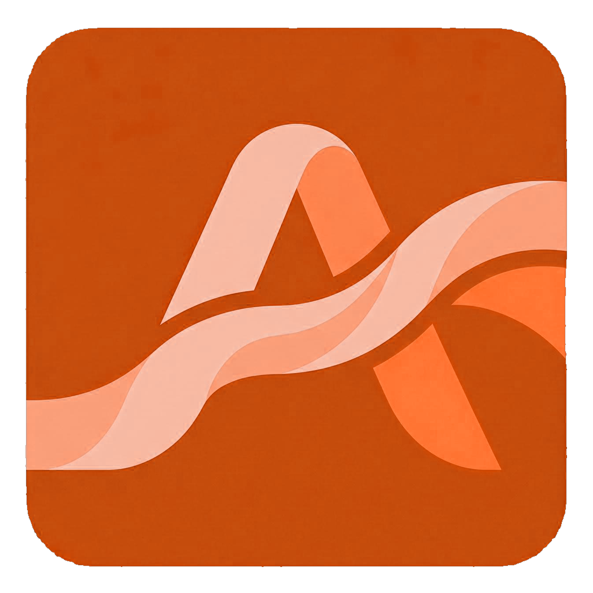

# 🪐 AlphaGravity — Kurumsal Yapay Zeka, RAG Bilgi Bankası, 3B Bilgi Ağı & Ses Köprüsü

  

  <b>C# (.NET 9 WPF), WebView2 3B Grafik Motoru ve Yerel/Bulut LLM Tabanlı Kurumsal Yapay Zeka İstemcisi</b>

  
  

---

## ✨ Temel Özellikler

- **🕸 3 Boyutlu Bilgi Grafiği (3D Knowledge Graph):** Şirket ve proje dokümanları arasındaki anlamsal ilişkileri interaktif 3B düğüm ağı olarak görselleştirir.
- **📚 RAG Kurumsal Hafıza & Öğrenme Raporu (`ManageKnowledgeWindow` & `LearningReportWindow`):** Teknik prosedürleri ve mimari dokümanları indeksleyerek bağlama duyarlı yanıtlar üretir.
- **🎙 VoiceBridge (Sesli Etkileşim Köprüsü):** Gerçek zamanlı ses tanıma (STT) ve seslendirme (TTS) entegrasyonu.
- **🌸 AlpTogether Entegrasyonu:** **[AlpTogether İstemcisi](https://github.com/alphankilicaslan/AlpTogether)** üzerinden tek tıkla kurulabilir, güncellenebilir ve onarılabilir.
